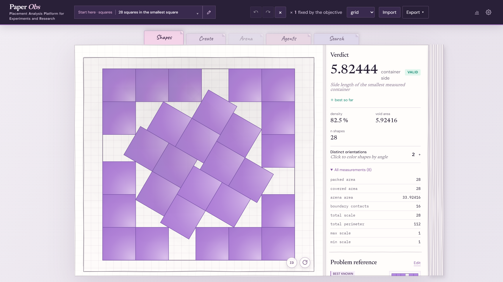
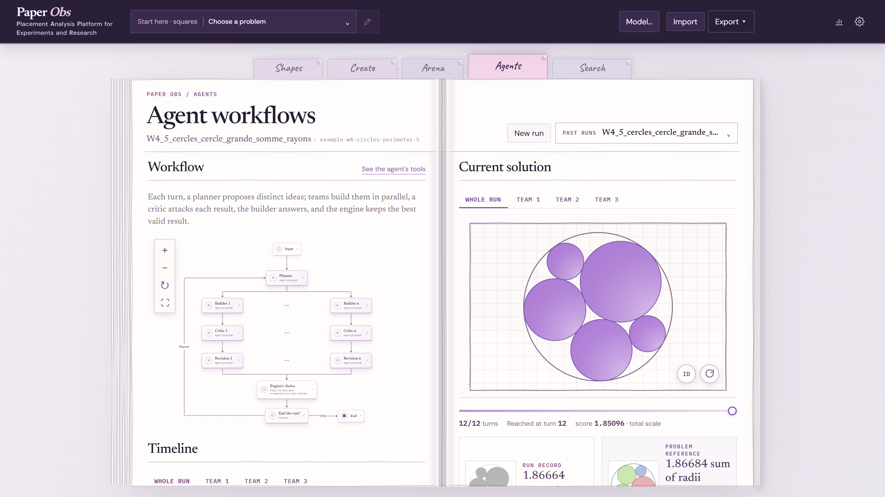
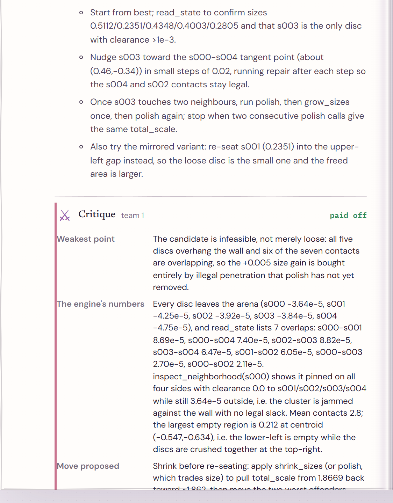
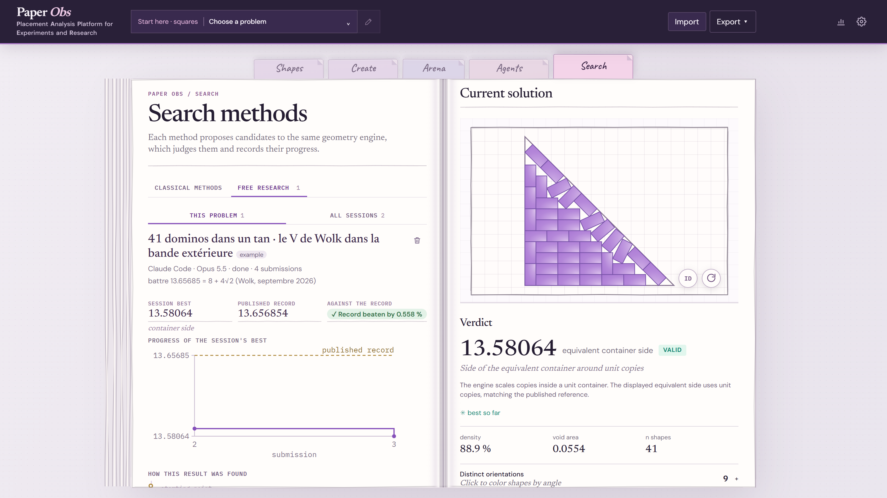

# Paper Obs

An open-source visual workbench for 2D geometric placement problems: define problems, inspect solutions, and compare human, algorithmic and multi-agent strategies.

**PAPER** means *Placement Analysis Platform for Experiments and Research*. **Obs** is the observatory: a place to inspect geometric problems, candidates, search traces and comparisons.

Paper Obs is an experimental lab for geometric placement problems in the plane: packing copies of a shape into the smallest container, covering a region, maximising a total perimeter. Define a problem, edit a candidate on a canvas, let a deterministic engine judge it, and compare a human, a classical search strategy, a LangGraph workflow or a free agent on the same instance. Its goal is a transparent comparison of methods; the few published records it has beaten are shown with the previous record beside them, as constructions to check rather than proofs.

The interface is available in French and English. The code and public documentation are in English.



*28 unit squares in the smallest square: the best-known construction (David Ellsworth, 2025), not a proved optimum, loaded from the catalog and judged valid by the engine.*

## What works today

- JSON problems and candidates with several objectives: fixed-count scale, fixed-size count, smallest container, covering, and maximum total perimeter.
- Discs, regular polygons and connected custom polygonal shapes; composite arenas built from boolean operations.
- A geometry engine that reports validity, score, measurements and violations; a web editor, candidate import/export and SVG rendering.
- Seeded generators and two classical baselines, `lattice` and `basin_hopping`, with convergence curves.
- Four LangGraph workflows, from a basic agent loop to a research lab of builder and critic teams with an optional Python sandbox, with a live run trace, workflow diagram, replay, run comparison and statistics.
- Separate **Agents** and **Search** workspaces: the former shows agent workflows, while the latter runs classical baselines and follows free research sessions.
- Free research: an outside agent such as Claude Code or Codex searches with its own programs, the engine judges every arrangement it submits, and the web app follows its journal live.
- A reference catalog checked on 2026-10-14 with 107 families and 4,445 entries, plus a [dated source audit](docs/catalog-update-2026-10-14.md). Source consultation and engine validation have separate dates; ambiguous source values remain explicitly unknown. A catalog card being present does **not** imply that its reference value has been independently proved or that the current engine supports its family.

Known limits and the meaning of a reference score are in the [documentation](docs/README.md).

## Agent workflows

The **Agents** tab runs a LangGraph workflow on the open problem and keeps everything it did: the graph, each turn's plan, every model reply and tool call, the arrangements the engine judged and what the run spent. A run can be replayed turn by turn, resumed, compared with other runs of the same problem, and summed up in a statistics page.



*The W4 example run on 5 circles in a circle with the largest total radius: the workflow's graph, drawn from its compiled LangGraph graph, beside the best arrangement of the whole run or of each team.*



*One turn of the trace: the team's plan, then the critic's attack on the builder's result, backed by the engine's numbers. The builder answers it, and the engine says whether the critique paid off.*

## Free research

Free research is the other way to put an agent to work: no graph and no fixed tools. Open this repository in an agent harness such as Claude Code or Codex and ask it for a free research session, on a problem you name or on one it proposes. The agent follows [research mode](docs/research-mode.md): it audits the machine and proposes how much of the processor to use before any long computation, opens a session, then searches with programs of its own. The engine judges every arrangement it submits. Run `paper-obs serve` and open **Search ▸ Free research** to follow the session live: its ideas, programs, dead ends, invalid attempts and new bests, and how its best compares with the published record. Sessions and their programs stay in the ignored `runs/research/` folder.



*The 41 dominoes example session: the published record beaten by 0.558 %, the progress of the session's best against the record, then how the result was found and the journal, beside the arrangement the engine judged.*


Packing references and published constructions are credited to [Erich's Packing Center](https://erich-friedman.github.io/packing/index.html), reused with Erich's permission. Independently hosted sources retain their own attribution.

A successful record hunt ends by preparing a private submission dossier. Select
prepared sessions in **Search ▸ Free research ▸ All sessions** to download a batch
of correctly named images, page-level values and an email draft. Coordinates and
checks stay local; the [research guide](docs/research-mode.md#6-submitting-to-the-source)
explains the required image review and recipient requirements.

## Install and test

Requires Python 3.11 or later. Node 20 or later is used for the web build.

```bash
python3 -m venv .venv
.venv/bin/pip install -e ".[dev,api,agents]"
.venv/bin/python -m pytest -q
cd apps/web
npm ci
npm run build
```

W4's optional Python sandbox also needs [Deno](https://deno.com/); see [the Python sandbox](docs/strategies-and-runs.md#the-python-sandbox).

On Windows, use the corresponding `.venv\Scripts\` executables, or the repository's `paper-obs.bat` launcher if WSL is configured. The launcher starts the server inside WSL.

## Try it

```bash
.venv/bin/paper-obs info -p examples/circle_25_in_square.json
.venv/bin/paper-obs init -p examples/circle_25_in_square.json -o runs/grid.json --svg runs/grid.svg
.venv/bin/paper-obs evaluate -p examples/circle_25_in_square.json -c runs/grid.json
.venv/bin/paper-obs serve
```

`serve` uses a local address, chooses an available port starting at 8000, and opens the browser. Build the frontend first as shown above. For frontend development, `cd apps/web && npm run dev` proxies API requests to the local server.

Agent runs require a configured provider, except for a local keyless provider such as Ollama. You can enter a key in the model dialog; it is kept in this browser and never written into a run document. `PAPER_OBS_API_KEY` is a **server operator** fallback; do not set it on a server available to untrusted visitors. If you configure token prices, the UI can estimate spend. Run documents are stored under ignored `runs/`.

Without API credit, the `claude-code` and `codex` providers run the workflows on a Claude or ChatGPT **subscription**: each model call starts the Claude Code or Codex CLI installed and signed in on this machine (`claude -p` with its tools off, `codex exec` read-only in an empty folder), which answers the conversation and the lab's tool schemas with a JSON reply (`paper_obs.llm.subscription`). Name the executable with `PAPER_OBS_CLAUDE_CLI` or `PAPER_OBS_CODEX_CLI` when it is not on the server's `PATH`, for example a Windows `claude.exe` used from WSL. It is slower than an API, since every call starts a process, and records tokens without a price. Driving a subscription from a program is a grey zone of the providers' terms: use it at your own judgement. The Codex adapter follows the documented `codex exec` options but has not been run against a real Codex install yet.

## First visit

The **Shapes** tab opens on five categories: **Start here · squares**, **Explore packing**, **Other objectives**, **Demo Workflow** (the problems the agent workflows are compared on) and **Records beaten by Claude**. The **Agents** tab ships one example run per workflow, and **Search ▸ Free research** ships two example record hunts, so a first visitor can read agent traces and a research journal without spending anything.

## Design

```text
domain       problem and candidate data, JSON contracts
geometry     validity, score, measurements, view model and SVG
search       candidate operators and classical baselines
workflows    LangGraph control, model calls and engine tools
storage      JSON artefacts
cli / ui     human control and display
```

The browser draws the geometry view returned by the engine; it does not make geometric decisions. Operators propose candidates and the engine judges them. The workflow code is deliberately concise so that it can also serve as the source for a video explaining multi-agent orchestration.

Start with the [documentation index](docs/README.md) for architecture, objectives and catalog provenance, precision, strategies, development and limitations. Contributor rules are in [AGENTS.md](AGENTS.md).

## Contributing

Forks are welcome, and pull requests are welcome when you want a change included in Paper Obs. You can maintain your own fork without sending a PR. See [CONTRIBUTING.md](CONTRIBUTING.md) for the workflow and review expectations. The project is maintained with limited review time, so a PR does not imply a guaranteed response or merge.

## License

[MIT](LICENSE). Reference websites and linked images retain their own terms; review attribution and redistribution rights before republishing catalog assets.
