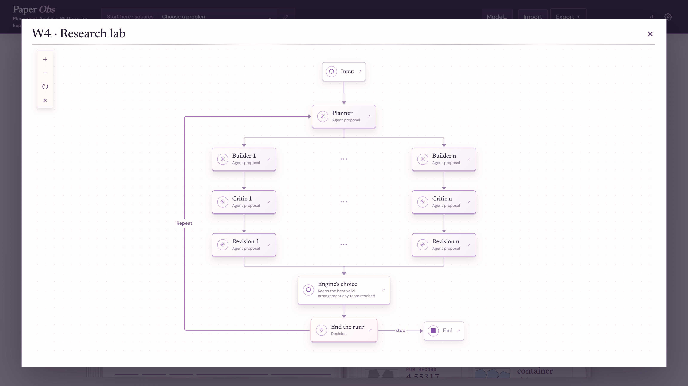

# Paper Obs

An open-source visual workbench for 2D packing and covering: define problems, inspect solutions, and compare human, algorithmic and multi-agent strategies.

**PAPER** means *Placement Analysis Platform for Experiments and Research*. **Obs** is the observatory: a place to inspect geometric problems, candidates, search traces and comparisons.

Paper Obs is an experimental lab for two-dimensional packing and covering. Define a problem, edit a candidate on a canvas, let a deterministic engine judge it, and compare a human, a classical search strategy or a LangGraph workflow on the same instance. Its goal is a transparent comparison of methods, not a claim to world records.

The interface is available in French and English. The code and public documentation are in English.


*28 unit squares in the smallest square: the best-known construction (David Ellsworth, 2025), not a proved optimum, loaded from the catalog and judged valid by the engine.*



*The Agents tab draws each workflow as a diagram checked against its compiled LangGraph graph: here W4, where teams of a builder and a critic work in parallel.*

## What works today

- JSON problems and candidates with several objectives: fixed-count scale, fixed-size count, smallest container, covering, and maximum total perimeter.
- Discs, regular polygons and connected custom polygonal shapes; composite arenas built from boolean operations.
- A geometry engine that reports validity, score, measurements and violations; a web editor, candidate import/export and SVG rendering.
- Seeded generators and two classical baselines, `lattice` and `basin_hopping`, with convergence curves.
- Four LangGraph workflows, from a basic agent loop to a research lab of builder and critic teams with an optional Python sandbox, with a live run trace, workflow diagram, replay, run comparison and statistics.
- Separate **Agents** and **Search** workspaces: the former shows agent workflows, while the latter runs classical baselines and outlines future solver methods.
- A reference catalog snapshot with 107 families and 2,847 entries. A catalog card being present does **not** imply that its reference value has been independently proved or that the current engine supports its family. The interface distinguishes these cases.

Known limits and the meaning of a reference score are in the [documentation](docs/README.md).

## Install and test

Requires Python 3.11 or later. Node 20 or later is used for the web build.

```bash
python3 -m venv .venv
.venv/bin/pip install -e ".[dev,api,agents]"
.venv/bin/python -m pytest -q
cd apps/web
npm ci
npm run build
```

W4's optional Python sandbox also needs [Deno](https://deno.com/); see [the Python sandbox](docs/strategies-and-runs.md#the-python-sandbox).

On Windows, use the corresponding `.venv\Scripts\` executables, or the repository's `paper-obs.bat` launcher if WSL is configured. The launcher starts the server inside WSL.

## Try it

```bash
.venv/bin/paper-obs info -p examples/circle_25_in_square.json
.venv/bin/paper-obs init -p examples/circle_25_in_square.json -o runs/grid.json --svg runs/grid.svg
.venv/bin/paper-obs evaluate -p examples/circle_25_in_square.json -c runs/grid.json
.venv/bin/paper-obs serve
```

`serve` uses a local address, chooses an available port starting at 8000, and opens the browser. Build the frontend first as shown above. For frontend development, `cd apps/web && npm run dev` proxies API requests to the local server.

Agent runs require a configured provider, except for a local keyless provider such as Ollama. You can enter a key in the model dialog; it is kept in this browser and never written into a run document. `PAPER_OBS_API_KEY` is a **server operator** fallback; do not set it on a server available to untrusted visitors. If you configure token prices, the UI can estimate spend. Run documents are stored under ignored `runs/`.

## Design

```text
domain       problem and candidate data, JSON contracts
geometry     validity, score, measurements, view model and SVG
search       candidate operators and classical baselines
workflows    LangGraph control, model calls and engine tools
storage      JSON artefacts
cli / ui     human control and display
```

The browser draws the geometry view returned by the engine; it does not make geometric decisions. Operators propose candidates and the engine judges them. The workflow code is deliberately concise so that it can also serve as the source for a video explaining multi-agent orchestration.

Start with the [documentation index](docs/README.md) for architecture, objectives and catalog provenance, precision, strategies, development and limitations. Contributor rules are in [AGENTS.md](AGENTS.md).

## Contributing

Forks are welcome, and pull requests are welcome when you want a change included in Paper Obs. You can maintain your own fork without sending a PR. See [CONTRIBUTING.md](CONTRIBUTING.md) for the workflow and review expectations. The project is maintained with limited review time, so a PR does not imply a guaranteed response or merge.

## License

[MIT](LICENSE). Reference websites and linked images retain their own terms; review attribution and redistribution rights before republishing catalog assets.
